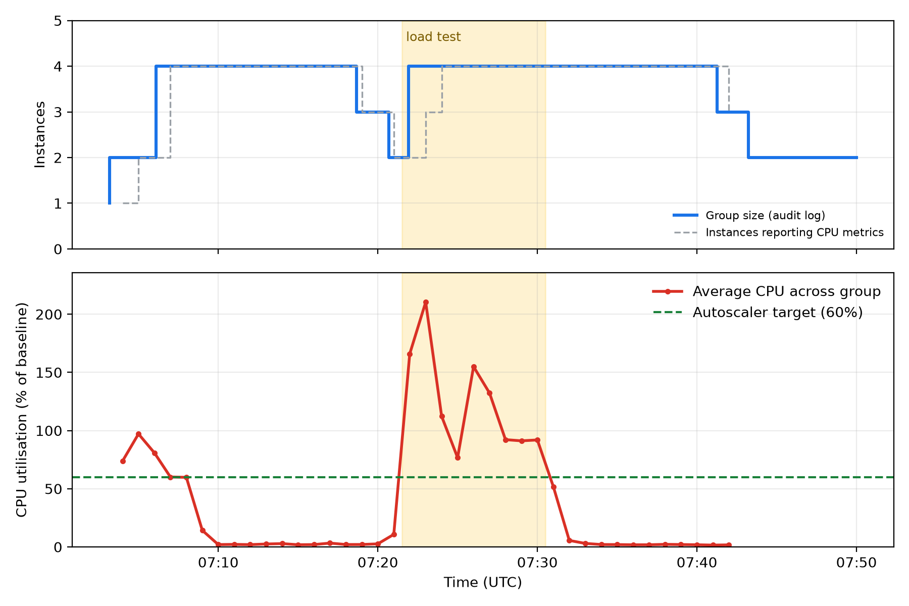

# Scalable Cloud-Based Product Inventory and Stock Management System

**Design and Implementation of a Scalable Cloud-Based Product Inventory and Stock Management System Using Compute Engine and Autoscaling**

Course mini project for **24CS010 Cloud Foundations**, B.Tech. Artificial Intelligence and Machine Learning (Regulation 2024), R.M.D. Engineering College, Kavaraipettai. Built only on Google Cloud.

| | |
|---|---|
| Subject | 24CS010 Cloud Foundations |
| Teaching faculty | Mrs. Margaret Flora B, Assistant Professor, Department of Artificial Intelligence and Machine Learning |
| Head of Department | Dr. C. S. Anita, Professor and Head |

## What it is

A stock management web application (products, stock in/out, low-stock alerts, audited stock movements) that runs on a **Compute Engine managed instance group** behind a **global HTTP load balancer**. An **autoscaler** adds VMs when CPU load rises and removes them when it falls. All state lives in **Cloud Firestore**, so any VM can serve any request and VMs can come and go freely.

```
                 Internet
                    |
        Global external HTTP load balancer  (static IP, health checks)
                    |
        Regional managed instance group  (asia-south1, spread over zones a/b/c)
        autoscaler: 2-4 x e2-small, target CPU 60%
          |        |        |        |
        VM-a     VM-b     VM-c     VM-c     Flask + gunicorn, stateless
          \        \       /        /
                 Cloud Firestore   (products, movements)
        Cloud Storage: app bundle pulled by each VM at boot
```

Google Cloud services used: Compute Engine (instance templates, managed instance groups, autoscaler, autohealing), Cloud Load Balancing, Cloud Firestore, Cloud Storage, Cloud IAM (dedicated least-privilege service account), VPC firewall with IAP-only SSH, Cloud Monitoring and Cloud Logging.

## Repository layout

```
app/        Flask API + single-page UI (main.py, templates/index.html)
deploy/     gcloud scripts: deploy.sh, seed.sh, loadtest.sh, capture_evidence.sh,
            analyze_autoscaling.py, teardown.sh
docs/       app and Google Cloud Console screenshots, raw evidence (gcloud output, audit log, latency samples) and charts
```

## Run it yourself

Prerequisites: `gcloud` logged in, a project with billing enabled.

```bash
export PROJECT_ID=your-project-id
./deploy/deploy.sh        # ~5 minutes; prints the load balancer URL
./deploy/seed.sh          # 12 sample products
./deploy/loadtest.sh 540 24   # drive CPU load, watch the group scale out
./deploy/teardown.sh      # delete everything that costs money
```

The load balancer takes a few minutes after creation to serve consistently; early requests can return a Google 404 page until its configuration has propagated.

## API

| Method | Path | Purpose |
|---|---|---|
| GET | `/healthz` | health check used by the load balancer and autohealing |
| GET/POST | `/api/products` | list / create a product |
| PUT/DELETE | `/api/products/<sku>` | update details / delete |
| POST | `/api/products/<sku>/stock` | `{"delta": 10}` receive or `{"delta": -1}` sell; transactional, rejects overselling |
| GET | `/api/summary` | product count, units, inventory value, low-stock list |
| GET | `/api/movements` | latest audited stock movements |
| GET | `/api/whoami` | which VM answered (shows load balancing) |
| GET | `/api/burn?ms=1500` | bounded CPU burner used only to demonstrate autoscaling |

## Design notes

- **Stateless VMs.** No product data or session lives on a VM, which is what makes scale-in safe.
- **Transactional stock changes.** Stock moves through a Firestore transaction, so two VMs selling the last unit at once cannot drive stock negative.
- **Least privilege.** VMs run as a dedicated service account with only Firestore user, log writer and metric writer roles, plus read on one bucket.
- **No public SSH.** The default SSH/RDP rules were removed; SSH is reachable only through Identity-Aware Proxy. Port 8080 accepts traffic only from Google's load balancer and health check ranges.
- **Autoscaler settings.** Target CPU 60%, minimum 2 for zone redundancy, maximum 4, 180 s initialization period (longer than VM boot, otherwise the boot-time CPU spike triggers a needless scale-out), scale-in limited to one VM per 2 minutes.

## Results

One run on 24 October 2026, project `inventory-gce-24cs010`, region asia-south1, 24 clients calling `/api/burn?ms=1500` for 540 s through the load balancer.

| Metric | Value |
|---|---|
| Autoscaler reaction (load start to scale-out) | 24 s (2 to 4 instances) |
| New VM ready (passes health check) | about 2 minutes (between 1 min 51 s and 2 min 33 s) |
| Scale-in after load ended | first step 11 min later, then 1 VM per 2 min, back to 2 |
| Peak average CPU | 210% of baseline (e2-small is shared-core, so above 100% is possible); stayed above the 60% target for the whole test, so the group sat at its maximum |
| `/api/summary` latency, at rest (2 VMs) | median 92 ms, p95 111 ms |
| `/api/summary` latency, under load (4 VMs) | median 1,119 ms, p95 3,651 ms, 20 of 20 returned 200 |
| Functional API checks | 12 of 12 passed (including oversell rejection) |
| Load balancing | 12 requests spread 3, 3, 3, 3 across the 4 VMs |



Things that went wrong and were fixed (worth knowing before you run it): an IAM etag conflict right after creating the service account (retry added), a new global load balancer returning Google 404s for about 5 minutes while it propagates, and a boot-time CPU spike that triggered an unneeded scale-out until the autoscaler initialization period was raised from 90 s to 180 s.

Limits: one run, 20-sample latency probes, and a deliberately CPU-heavy workload, so treat the timings as one observation and not as averages.

Raw evidence is in `docs/evidence/` and the data behind the chart in `docs/autoscaling.csv`.
